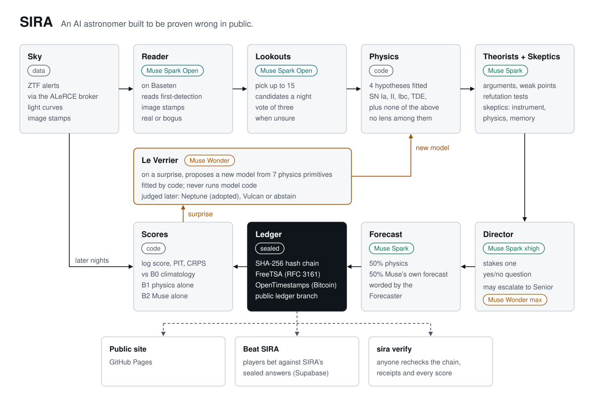
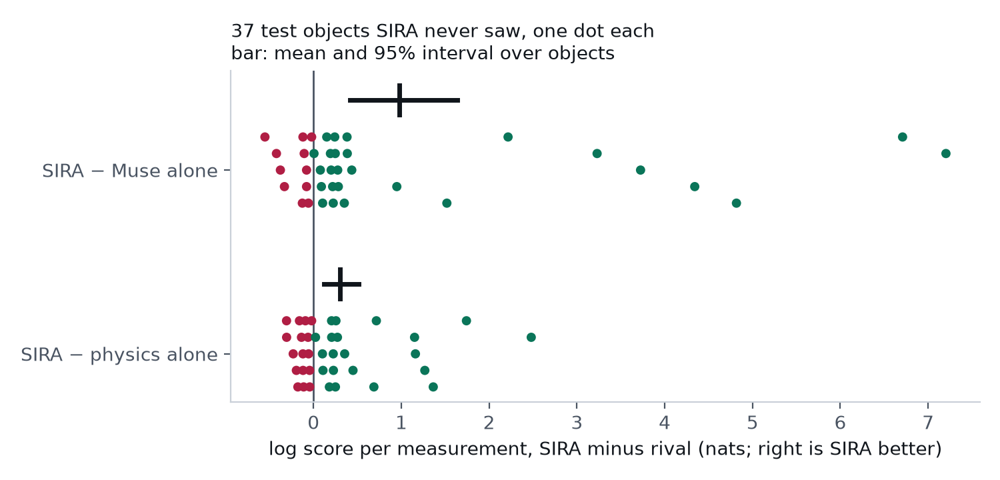

# SIRA

**An AI astronomer built to be proven wrong in public.**

SIRA investigates cosmic transients — supernovae, tidal disruption events, microlensing — using public alerts from real sky surveys (ZTF, via the ALeRCE broker). It proposes rival physical hypotheses, registers quantitative predictions *before* new observations arrive, and lets the data grade them. It decides when to wait, think harder, or ask for help, and it keeps a public, timestamped record of every bet.

Built by Alejandro Cornejo (solo, Indie track) for the Meta Global AI Developer Hackathon 2026, *Push the Frontier*, with Meta's Muse models. Built with Muse Spark Open.

Site: **https://alehcs.github.io/sira/** (the lab, Beat SIRA, the forecasts and the archive). Live ledger: the [`ledger`](https://github.com/Alehcs/sira/tree/ledger) branch.

> Status: betting live every night since October 27, 2026. ZTF has sent no new data since October 29, 13:18 UTC; questions whose answer window falls in that gap are void by the sealed rule, reported and not counted.



## What it showed

On 37 objects from a test split it had never seen, in an evaluation pre-registered and timestamped before it ran ([`evidence/plan.json`](evidence/plan.json)):

- **It forecast better than Muse alone and than its own physics alone.** SIRA minus Muse alone: +0.98 nats per measurement (95% interval 0.41 to 1.64), about 2.7 times the probability on what the sky actually did. SIRA minus physics alone: +0.30 (0.12 to 0.52), about 1.35 times. Both hold in each of the two runs. The edge comes from pooling physics with Muse's own forecast; on plain SN Ia, physics alone is slightly better.
- **The edge is Muse's, not averaging's.** Measured after the plan, so not pre-registered: pooling the same physics with climatology instead of Muse's forecast loses 0.30 nats per measurement (0.11 to 0.54), although alone Muse scores about the same as climatology.
- **When the sky surprised it, Muse Wonder proposed an invisible lens.** Wonder builds models from 7 physical pieces, a lens among them, while the lab's own hypotheses never include one. On 4 of the 6 surprises the lens forecast the data it had not seen far better than the old hypotheses, and no SN Ia surprised the physics. In the full replays it also put a lens on a superluminous supernova, and won its test there because the lab has no superluminous model: one false discovery. One Le Verrier did as well as five, at a fifth of the cost.
- **Our own idea failed its pre-registered test.** With no pieces to build from, Wonder wrote the gravitational lens law itself, the one Einstein published in 1936, on 2 of the 6 test lensing events, and where the lab kept it, it won by log10 E 143. But its free equations won less often than the pieces (2 of 6 against 4) and also won on 3 of 4 surprises that were not lenses, so SIRA keeps the pieces ([`evidence/equations`](evidence/equations)).
- **Its surprise alarm never rang for an ordinary supernova.** On 112 test objects it rang 10 times: on 6 lensing events and 4 rare transients, and on none of the 43 SN Ia and core-collapse supernovae. It stays quiet on most unusual objects too (59 of 69): it tells you where to look, not everything worth looking at.
- **Its physics code puts a supernova's host galaxy near the right distance from the light curve alone:** median redshift error 5.6% on 18 well-measured SN Ia, 12.3% on all 29, above the 10% bar its acceptance test sets for all fits.
- **Its physics code says "I don't know".** Asked whether a light curve is a gravitational lens or a supernova, it was right on all 26 decisive verdicts and abstained on 7 of 33.
- **An investigation costs about US$0.16** in Muse calls.

Every number, and what SIRA may and may not claim, is in [CLAIMS.md](CLAIMS.md), with the figures in [`evidence/figures`](evidence/figures).



## Meta's models in SIRA

| Role | Model | What it does |
|---|---|---|
| Stamp reader | Muse Spark Open, on Baseten | reads each candidate's first-detection images: real or bogus |
| Lookouts | Muse Spark Open, on Baseten | pick up to 15 candidates a night; three vote when one is unsure |
| Theorists and skeptics | Muse Spark | argue for the top hypotheses, attack them as instrument, physics and memory skeptics |
| Director | Muse Spark, xhigh effort | stakes one yes/no question on each object; may ask the senior |
| Senior | Muse Wonder, max effort | reviews escalations and a random 10% of plain bets |
| Muse alone | Muse Spark, high effort | gives its own light-curve forecast, pooled 50/50 with the physics |
| Forecaster | Muse Spark, minimal effort | words the question and its odds |
| Le Verrier | Muse Wonder | when the sky surprises the lab, writes a new physical model from 7 primitives; code fits it and the future judges it |

Muse never runs code and never sees an object's name or date: it gets opaque ids and relative days, so it cannot look the answer up in its memory. It does see the galactic latitude, rounded to 5 degrees. Before building that firewall we measured what Muse remembers: asked about 40 real ZTF transients by name and by sky position, Wonder recalled 5 of the 16 brightest, the newest from July 2025, and Spark 3; neither recalled any of the other 24 ([`evidence/memory`](evidence/memory)).

Model ids: `muse-spark-1.3` and `muse-wonder-1.0` on Meta's Model API, and `meta-models/muse-spark-open-1026` on Baseten ([`config.py`](src/sira/config.py), [`agents.py`](src/sira/agents.py)). Spark also writes the site's Spanish notes. Every call is an `event` in the public ledger with its model, effort, seconds and cost. The `openai` package in [`llm.py`](src/sira/llm.py) is only the client for these OpenAI-compatible endpoints; no OpenAI model is called.

## Open weights

Built with Muse Spark Open. Every candidate SIRA considers meets Muse Spark Open first, served by Baseten (`meta-models/muse-spark-open-1026`): the reader judges its first-detection images, real or bogus, and the lookouts pick which ones get the full team. It runs in every nightly job, every Beat SIRA round and every Investigate run, with no fallback to another model; look for the `reader` and `lookout` events in `ledger.jsonl`.

On 160 held-out ZTF candidates the reader tells a real source from a bad subtraction with 91.3% balanced accuracy (95% interval 86.9 to 95.6%, AUC 0.97), for about one US cent a read. The real ones are 2024 supernovae of the Bright Transient Survey and the bogus ones carry ALeRCE's stamp classifier labels; every read is in [`evidence/reader`](evidence/reader).

## Built during the hackathon

Kickoff was Monday, October 26, 2026 at 12:00 ET (16:00 UTC). This repository was created at 23:33 UTC that day, and every line of code, prompt, test, figure and page in it was written after that, in the commits on `main` (times below in Chile, UTC−3):

- October 26: the Meta and Baseten clients, spend caps and the data snapshot clients.
- October 27: the time firewall, the physics library, scoring, the ledger, the agent team, Le Verrier, the replay and the first live bets.
- October 30: Beat SIRA, the public site and the replay ablations.
- October 31: the lab replay, the Spanish notes and the site.
- November 1: the pre-registered test evaluation (plan stamped by FreeTSA at 11:58 UTC, before any test object was replayed), its figures and claims, and the Docker reproduction.

The replay ledgers in `evidence/` carry sky time (2018 to 2025), not the time they ran. Not built here: the open-source libraries in `pyproject.toml` and `site/package.json`, the public data and images credited below, and the FreeTSA root certificate.

## Reproduce the numbers

```bash
git clone https://github.com/Alehcs/sira && cd sira
make reproduce        # tests, the ledger check and every number in CLAIMS.md, with no API keys
make docker           # the same in a clean container
make physics          # also reruns the distance and lens-or-supernova headlines from a fresh ALeRCE snapshot
```

`make reproduce` recomputes the results from the replay ledgers in `evidence/test`, the Le Verrier runs in `evidence/leverrier` and `evidence/equations`, the reader's reads in `evidence/reader`, the memory probe in `evidence/memory` and the public ledger, and fails if any number differs from `evidence/results.json`. Rerunning the replays themselves needs Meta and Baseten keys (`uv run sira replay --split test --per 10 --out evidence/test/a`) and about US$23 a run; Muse's answers vary between runs, which is why the plan has two.

## Check the bets yourself

Every evening a public GitHub Actions run scores SIRA's open bets against what the sky did, places new ones, and appends everything to `ledger.jsonl` on the `ledger` branch. Each entry carries the hash of the one before it, so changing any bet breaks every hash after it. The newest entry is then sealed with an RFC 3161 timestamp from FreeTSA and an OpenTimestamps proof that Bitcoin confirms within hours.

```bash
git clone https://github.com/Alehcs/sira && cd sira
git worktree add ledger origin/ledger
uv run sira verify --ledger ledger --online
```

`verify` checks every entry against the protocol below, rebuilds the hash chain, checks every receipt against the FreeTSA root shipped in this repository, checks that each bet was sealed within an hour of being made, recomputes every score and answer from the sealed forecast, opens SIRA's sealed Beat SIRA answers and rescores the players, and with `--online` checks every scored measurement against the ALeRCE archive. Pass a head you saw before (`--since SEQ:HASH`) to catch a rewritten history.

Without SIRA's code, for any sealed head `H`:

```bash
shasum -a 256 ledger/receipts/H.json        # prints H
openssl ts -verify -digest H -in ledger/receipts/H.tsr -CAfile src/sira/freetsa_ca.pem
ots verify ledger/receipts/H.json.ots       # needs a Bitcoin node
```

**What the receipts cannot prove.** They show that a bet existed at a given time, not that it was the only bet: someone running private copies could publish only the luckiest one. Here, every anchor names the commit and the Actions run that made it, and each run's log is public. Scores also depend on the photometry ALeRCE serves.

## The protocol

The ledger format is open, so any forecaster (a classifier, a broker, another AI scientist) can be graded the same way. Its schema is [`src/sira/ledger.schema.json`](src/sira/ledger.schema.json) (JSON Schema 2020-12).

- **Entries.** One JSON object per line of `ledger.jsonl`, with `seq`, `time`, `kind`, `payload`, `prev` and `hash`. `hash` is the SHA-256 of the entry without it, written as RFC 8785 JSON, and `prev` is the hash of the entry before.
- **Bets.** For each future time and band, the expected flux as a mixture of Gaussians (`[name, weight, mean, sd]`), plus an optional yes or no question with its probability. Rivals sealed beside it (`baselines`) are graded on the same data.
- **Anchors.** The head of the chain, stamped by FreeTSA (RFC 3161) and by OpenTimestamps. A bet counts from the first anchor that covers it.
- **Outcomes and answers.** Every measurement taken after the seal is scored for the bet and each rival (log score, PIT, CRPS), and each question is settled by the first measurement near its time.
- **Everything else.** `event` says who worked, with which model and at what cost; `surprise` and `verdict` come from Le Verrier; `round`, `reveal`, `crowd` and `crowd_answer` are Beat SIRA.

To hold your own forecaster to it, write its bets in this shape, anchor the head after each batch, append outcomes as the data arrive, and run `sira verify --ledger <dir>`.

## Repository layout

- `main` — the project: code, site, workflows and documentation.
- `ledger` — data only: SIRA's bets, timestamp receipts and resolutions, appended automatically every night. The code on `main` reads it; nobody needs to switch branches.

## Data and acknowledgments

SIRA uses only public data and open tools:

- Alerts, light curves and image stamps from the [Zwicky Transient Facility](https://www.ztf.caltech.edu) (ZTF), served by the [ALeRCE](https://alerce.science) broker.
- Classifications and redshifts from the [ZTF Bright Transient Survey](https://sites.astro.caltech.edu/ztf/bts/explorer.php), with their [Transient Name Server](https://www.wis-tns.org) names.
- Rubin Observatory alerts with their TNS types through the [Fink](https://fink-broker.org) broker, in the data snapshot; no result uses them yet.
- Host galaxy images: Legacy Surveys / D. Lang (Perimeter Institute), [CC BY 4.0](https://creativecommons.org/licenses/by/4.0/), from the [DESI Legacy Imaging Surveys](https://www.legacysurvey.org/acknowledgment/), and [Pan-STARRS1](https://outerspace.stsci.edu/display/PANSTARRS/) through the Legacy Surveys viewer.
- Milky Way reddening from the IRSA dust service (Schlafly & Finkbeiner 2011).
- The ZTF DR17 microlensing catalog by Zhai et al. ([doi:10.5281/zenodo.13829674](https://doi.org/10.5281/zenodo.13829674), [arXiv:2311.18627](https://arxiv.org/abs/2311.18627)), [CC BY 4.0](https://creativecommons.org/licenses/by/4.0/); its values are reformatted in `evidence/truth.json`.
- Supernova models from [SNCosmo](https://sncosmo.readthedocs.io) (SALT3), and [Astropy](https://www.astropy.org).
- Timestamps from [FreeTSA](https://freetsa.org) and [OpenTimestamps](https://opentimestamps.org).
- Meta's Muse Spark and Muse Wonder through Meta's API, and Muse Spark Open through [Baseten](https://www.baseten.co).

## License

MIT for the code — see [LICENSE](LICENSE). The data and images keep their own terms, listed above.
